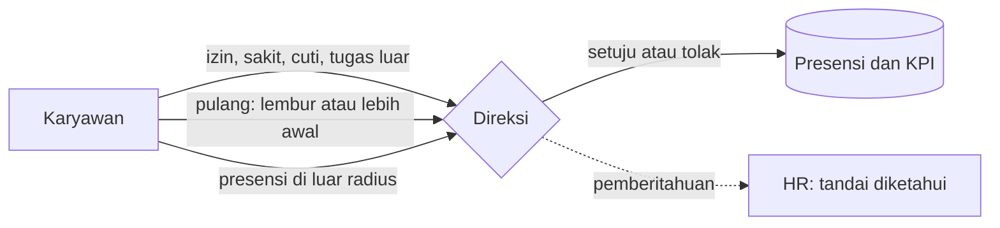
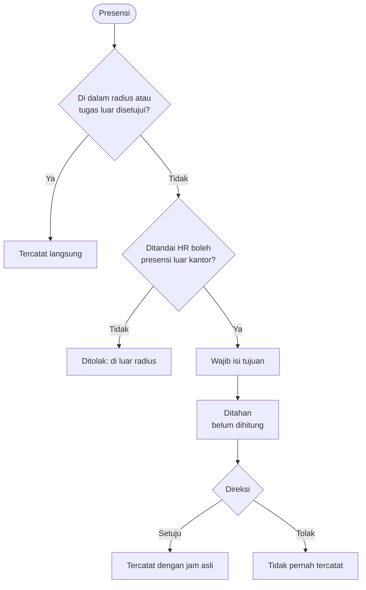

<div align="center">

# E-Presensi BPRS

**Presensi GPS + selfie, persetujuan berjenjang Direksi, dan KPI disiplin — dalam satu aplikasi Laravel.**


[Mulai cepat](#-mulai-cepat) · [Fitur](#-fitur) · [Alur kerja](#-alur-kerja) · [Deploy](#-deploy-ke-hostinger) · [Konfigurasi](#-konfigurasi) · [FAQ](#-pemecahan-masalah)

</div>

---

## Ringkasan

Dua portal dalam satu aplikasi:

| Portal | URL | Login | Guard | Untuk |
|---|---|---|---|---|
| **Karyawan** (mobile-first) | `/` | NIK + sandi | `karyawan` | Presensi, riwayat, pengajuan, profil |
| **Panel** (desktop) | `/panel` | Email + sandi | `user` | Monitoring, persetujuan, laporan, KPI, data master |

Tiga peran panel dengan tanggung jawab yang jelas:

| Peran | Tugas utama |
|---|---|
| **Direksi** | Satu-satunya yang **menyetujui/menolak**: izin, sakit, cuti, tugas luar, lembur, pulang lebih awal, dan presensi luar kantor. Juga memantau dashboard, KPI, dan laporan. |
| **HR** | Mengelola data karyawan & pengaturan, **menerima pemberitahuan** (tombol *Tandai diketahui*), dan **mengoreksi presensi** bila karyawan tidak bisa presensi. |
| **Admin** | Semua yang dilakukan HR, ditambah lokasi kantor, jam kerja, akun panel, dan log aktivitas. |

> [!NOTE]
> **Status verifikasi.** Fondasi (presensi, izin/sakit/cuti, KPI) sudah berjalan di produksi. Fitur tahap berikutnya
> (peran Direksi, tugas luar, lembur, pulang lebih awal, koreksi HR, presensi luar kantor) ditulis dengan test otomatis
> dan pemeriksaan statis, tetapi **jalankan `php artisan test` dan uji manual** sebelum dipakai seluruh karyawan.

---

## ✨ Fitur

| | Fitur | Ringkas |
|---|---|---|
| 📍 | **Presensi GPS + selfie** | Validasi di server: radius kantor (Haversine), akurasi GPS, jendela jam, satu baris per karyawan per hari |
| 📝 | **Izin / Sakit / Cuti** | Tanpa kuota bulanan: izin/sakit berdokumen bebas potong, tanpa surat memotong cuti; kekurangan saldo dipinjam dari tahun depan |
| 🚗 | **Tugas luar** | Disetujui Direksi dulu; presensi tetap wajib (selfie + GPS) tetapi radius kantor dilewati |
| ⏱️ | **Lembur** | Pulang melewati batas lembur → keterangan wajib → disetujui Direksi, diketahui HR |
| 🚪 | **Pulang lebih awal** | Boleh untuk keperluan mendadak dengan alasan wajib; keputusan Direksi menyusul |
| 📱 | **Presensi QR (tanpa foto)** | Karyawan memindai QR yang **berganti otomatis** di layar kantor; GPS tetap divalidasi diam-diam di server |
| 🏪 | **Presensi luar kantor** | Untuk karyawan yang ditandai HR (mis. menagih angsuran): **ditahan** sampai Direksi menyetujui, lalu tercatat dengan jam asli |
| ✏️ | **Koreksi presensi** | HR/Admin mengoreksi dengan alasan wajib; jam asli, pelaku, dan waktu tersimpan permanen |
| 📊 | **KPI disiplin** | Skor bulanan berbobot, kategori, ekspor CSV, rumus & bobot dapat diubah dari menu Pengaturan |
| 🗂️ | **Laporan** | Laporan presensi per karyawan, rekap bulanan, CSV aman dari formula injection |
| 🔒 | **Keamanan** | Foto privat, rate limit, CSRF, jejak audit, retensi foto otomatis |

---

## 🔄 Alur kerja

### Peran dan persetujuan



### Keputusan saat karyawan menekan tombol presensi



### Siapa boleh melakukan apa

| Aksi | Karyawan | HR | Direksi | Admin |
|---|:-:|:-:|:-:|:-:|
| Presensi, ajukan izin/cuti/tugas luar | ✅ | — | — | — |
| Menyetujui / menolak (semua jenis) | — | — | ✅ | — |
| Tandai **diketahui** | — | ✅ | — | ✅ |
| Koreksi presensi | — | ✅ | — | ✅ |
| QR Kantor (cetak / ganti QR) | — | ✅ | — | ✅ |
| Monitoring, laporan, KPI (lihat) | — | ✅ | ✅ | ✅ |
| Data karyawan, departemen, hari libur, pengaturan | — | ✅ | — | ✅ |
| Lokasi kantor, jam kerja, akun panel, log | — | — | — | ✅ |

> Ingin Admin ikut bisa menyetujui? Ubah `role:direksi` menjadi `role:direksi,admin` di `routes/web.php` dan sesuaikan `User::bolehMemutuskan()`.

### Aturan per fitur

<details>
<summary><b>Presensi</b></summary>

Semua dicek di server dengan jam server (zona `Asia/Makassar`): lokasi terbaca → akurasi GPS ≤ batas → jarak ke kantor ≤ radius cabang →
hari kerja dan bukan libur → tidak sedang izin/sakit/cuti yang disetujui → masuk hanya pada jendela `awal_jam_masuk`–`akhir_jam_masuk`.
Presensi **mencurigakan** (akurasi > 50 m, atau koordinat identik tiga kali berturut-turut) diberi tanda *perlu review*; tidak ditolak otomatis.
</details>

<details>
<summary><b>Izin, sakit, cuti, tugas luar</b></summary>

Hari kerja dihitung dari jadwal karyawan dikurangi hari libur. Tanggal tidak boleh bentrok; sakit boleh diajukan mundur N hari; rentang satu pengajuan maksimal 366 hari.
Direksi menyetujui, menolak (alasan wajib), atau membatalkan keputusan. **Tugas luar** tidak memotong cuti, tetapi tujuan/lokasi wajib.

**Tidak ada kuota bulanan untuk izin/sakit.** Yang menentukan adalah dokumennya:

| Pengajuan | Memotong jatah cuti tahunan? |
|---|---|
| Izin/sakit dengan **keterangan dan surat (lampiran)** | Tidak |
| Izin/sakit **tanpa surat** atau **tanpa keterangan** | Ya, sebanyak hari kerjanya |
| Cuti | Ya |
| Tugas luar | Tidak |

**Pinjam dari jatah tahun depan.** Bila sisa cuti tidak cukup, kekurangannya dipotong dari jatah tahun berikutnya. Contoh: sisa 2 hari, cuti 4 hari → 2 hari dari sisa,
2 hari dipotong dari jatah tahun depan. Syaratnya jatah tahun depan masih cukup; bila tidak, pengajuan ditolak. Pengajuan yang memotong cuti tidak boleh lintas tahun
(ajukan terpisah per tahun). Pengajuan yang ditolak atau dibatalkan mengembalikan saldo. Izin/sakit lama (sebelum aturan ini) tidak dipotong surut.
</details>

<details>
<summary><b>Pulang lebih awal dan lembur</b></summary>

* **Sebelum jam pulang:** presensi tetap diterima, alasan wajib. Status *Menunggu*; Direksi memutuskan sesudahnya. Yang **disetujui** tidak dihitung pulang cepat di KPI; yang ditolak/belum diputuskan tetap dihitung.
* **Setelah jam pulang + batas lembur** (default 30 menit): keterangan lembur wajib. Status *Menunggu* → Direksi memutuskan, HR menandai diketahui.
</details>

<details>
<summary><b>Presensi QR (tanpa foto)</b></summary>

Opsi untuk karyawan yang sudah berada di kantor: login, buka **Presensi dengan QR**, lalu pindai QR kantor. Tidak ada selfie.
Nonaktif secara default; Admin menyalakannya di **Pengaturan → Presensi dengan QR**.

Dua jenis QR (Pengaturan → *Jenis QR*):

| | **Tetap** (bawaan) | **Berganti otomatis** |
|---|---|---|
| Cara pakai | Cetak dan tempel di **dalam** kantor (menu **QR Kantor** → Cetak) | Buka menu **QR Kantor** di tablet/monitor kantor yang selalu menyala |
| QR berubah | **Hanya saat Admin/HR menekan *Ganti QR*** (QR lama langsung tidak berlaku, cetak ulang) | Otomatis tiap `qr.berlaku_detik` (default 60 dtk) |
| Perangkat | Tidak perlu | Perlu layar yang menyala terus + internet |
| Risiko foto QR dikirim ke orang lain | **Lebih tinggi**: penghalang utamanya GPS | Rendah: foto cepat kedaluwarsa |

* Token bertanda tangan (HMAC dari `APP_KEY`) atas kode cabang + versi (tetap) atau slot waktu (berganti); tidak ada rahasia yang disimpan di database.
  Hanya berlaku untuk cabang karyawan itu. **Mengganti `APP_KEY` membuat QR tetap tidak berlaku** (cetak ulang).
* **GPS tetap berjalan dan divalidasi di server** (akurasi dan radius kantor), tetapi koordinat dan jarak tidak ditampilkan. Radius **ketat**: tugas luar dan izin
  presensi luar kantor tidak melonggarkannya, dan presensi QR tidak pernah ditahan. Pesan galat radius tidak menyebut jarak.
* **Saran untuk QR tetap:** tempel di tempat yang tidak terlihat dari luar kantor, ganti berkala (mis. tiap bulan) atau segera bila fotonya tersebar,
  dan pantau tanda *perlu review* serta koordinat yang berulang di Monitoring.
* Lembur dan pulang lebih awal tetap berlaku (keterangan diminta). Kolom `presensi.metode` mencatat `foto`, `qr`, atau `campuran`; tampil di Monitoring, Laporan, dan CSV.
</details>

<details>
<summary><b>Presensi luar kantor (menagih angsuran, kunjungan nasabah)</b></summary>

Hanya untuk karyawan dengan centang **Boleh presensi dari luar kantor** (form karyawan). Karyawan lain tetap ditolak di luar radius.
Presensi di luar radius **ditahan** (tabel `presensi_tahan`) dengan tujuan wajib, dan **belum dihitung** di rekap maupun KPI.
Disetujui Direksi → dipindah ke `presensi` dengan **jam asli**; ditolak → tidak pernah tercatat. Masuk dan pulang pada hari yang sama diputuskan bersama
bila salah satunya ditahan, dan lembur/pulang awal di dalamnya ikut disetujui. Yang sudah disetujui diubah lewat Koreksi Presensi.
</details>

<details>
<summary><b>Koreksi presensi</b></summary>

Untuk karyawan yang sama sekali tidak bisa presensi atau lupa presensi pulang. Alasan minimal 10 karakter; hanya 31 hari terakhir; hanya hari kerja
non-libur tanpa izin/cuti disetujui. Jam asli, pelaku, dan waktu koreksi tersimpan permanen, tercatat di Log Aktivitas, dan ditandai *Dikoreksi HR*
di Monitoring, Laporan, dan CSV. Jam pulang tidak dapat dikoreksi selagi pengajuan lembur/pulang awal pada presensi itu **menunggu** atau sudah **disetujui**; bila **ditolak**, jam pulang boleh dikoreksi dan pengajuan yang ditolak itu dihapus (jejaknya ada di Log Aktivitas).
</details>

<details>
<summary><b>KPI disiplin</b></summary>

Periode bulanan; hari mendatang dan hari ini yang belum presensi tidak dihitung.

```
kehadiran% = hadir / (hari kerja − izin/sakit/cuti disetujui)
ketepatan% = (hadir − terlambat) / hadir
disiplin%  = 100 − menit_terlambat × 0,2 − alpa × 10 − pulang_cepat × 2
skor       = rata-rata berbobot (default 40 / 40 / 20)
```
Kategori: ≥ 90 Sangat Baik · ≥ 80 Baik · ≥ 70 Cukup. Bobot dan penalti diubah dari menu **Pengaturan** tanpa deploy.
Ini KPI **kedisiplinan**; KPI kinerja pekerjaan adalah modul terpisah.
</details>

---

## 🚀 Mulai cepat

Prasyarat: **PHP 8.3+** (ekstensi `gd`, `mbstring`, `pdo_sqlite` atau `pdo_mysql`) dan **Composer 2**.

```bash
composer install
cp .env.example .env
php artisan key:generate
touch database/database.sqlite          # Windows: type nul > database\database.sqlite
php artisan migrate
php artisan db:seed                     # master minimal + akun admin (sandi acak, tampil SEKALI)
php artisan db:seed --class=DemoSeeder  # opsional: karyawan & presensi contoh
php artisan serve
```

Buka `http://localhost:8000` (karyawan) dan `http://localhost:8000/panel` (panel).
Data demo: karyawan **1001–1006**, sandi **karyawan123**. Kamera dan GPS hanya berfungsi di `localhost` atau **HTTPS**.

Buat akun panel, termasuk Direksi:

```bash
php artisan presensi:buat-pengguna direksi@bprs.test "Nama Direksi" --role=direksi
php artisan presensi:buat-pengguna hr@bprs.test "Nama HR" --role=hr
```
Atau lewat menu **Akun Panel** (Admin).

---

## ☁️ Deploy ke Hostinger

Dikerjakan lewat SSH (mis. Termius: port **65002**, user `u…`) dengan kode dari GitHub.

**1. Persiapan di hPanel**
- **PHP Configuration:** PHP **8.3+**, aktifkan `gd`, `mbstring`, `pdo_mysql`, `fileinfo`. Atur `memory_limit` **256M** dan `max_execution_time` **60**.
- **SSH Access:** aktifkan, catat IP, port, dan username.
- **Databases → MySQL:** buat database dan user.
- **Subdomain:** buat, arahkan *document root* ke `…/epresensi/public`. Aktifkan **SSL**.

**2. Pasang aplikasi**

```bash
cd ~/domains/domainanda.com
git clone https://github.com/<akun>/epresensi.git
cd epresensi
composer install --no-dev --optimize-autoloader
cp .env.example .env && nano .env
```

Isi `.env`:

```env
APP_ENV=production
APP_DEBUG=false
APP_URL=https://epresensi.domainanda.com
DB_CONNECTION=mysql
DB_HOST=127.0.0.1
DB_DATABASE=u123_presensi
DB_USERNAME=u123_user
DB_PASSWORD=...
SESSION_SECURE_COOKIE=true
ADMIN_EMAIL=email@domain.com
```

```bash
php artisan key:generate
php artisan migrate --force
php artisan db:seed --force        # CATAT sandi admin yang tampil, hanya sekali
chmod -R 775 storage bootstrap/cache
php artisan config:cache && php artisan route:cache && php artisan view:cache
php artisan presensi:buat-pengguna direksi@domain.com "Nama Direksi" --role=direksi
```

**3. Cron** (hPanel → Cron Jobs, setiap menit)

```
php /home/u123/domains/domainanda.com/epresensi/artisan schedule:run >> /dev/null 2>&1
```

**4. Sebelum dipakai:** login `/panel` → atur **Lokasi Kantor** (koordinat akurat), **Jam Kerja**, **Hari Libur**, lalu tambah karyawan.
Tandai karyawan yang boleh presensi luar kantor (bila ada).

<details>
<summary><b>Update berikutnya</b></summary>

```bash
cd ~/domains/domainanda.com/epresensi
git pull
composer install --no-dev --optimize-autoloader
php artisan migrate --force
php artisan optimize:clear
php artisan config:cache && php artisan route:cache && php artisan view:cache
```
Jika `git pull` mengeluh ada perubahan lokal, jangan langsung `git reset --hard`; periksa dulu dengan `git status`.
</details>

<details>
<summary><b>Alternatif tanpa mengatur document root</b></summary>

Salin isi `public/` ke folder web subdomain dan ubah dua baris di `index.php`:

```php
require __DIR__.'/../../epresensi/vendor/autoload.php';
$app = require_once __DIR__.'/../../epresensi/bootstrap/app.php';
```
Aplikasi jangan ditaruh di `public_html` agar `.env` tidak terbuka dari web.
</details>

---

## ⚙️ Konfigurasi

Default ada di `config/presensi.php`; sebagian dapat diubah HR/Admin dari menu **Pengaturan** (disimpan di tabel `pengaturan` dan menimpa default).

| Kunci | Default | Fungsi |
|---|---:|---|
| `gps.akurasi_maks` | 100 m | Presensi ditolak bila akurasi GPS lebih buruk |
| `gps.review_akurasi` | 50 m | Di atas ini diberi tanda *perlu review* |
| `foto.maks_kb` / `retensi_bulan` | 1500 / 12 | Ukuran foto dan masa simpan |
| `izin.sakit_mundur_hari` | 7 | Sakit boleh diajukan mundur |
| `izin.maks_rentang_hari` | 366 | Rentang satu pengajuan |
| `lembur.minimal_menit` | 30 | Batas setelah jam pulang sebelum wajib keterangan lembur |
| `qr.aktif` | nonaktif | Menyalakan presensi QR tanpa foto |
| `qr.mode` | tetap | `tetap` (dicetak, diganti manual) atau `berganti` (otomatis di layar) |
| `qr.berlaku_detik` | 60 | Mode berganti: QR berganti tiap sekian detik (token berlaku 1x–2x), batas 15–600 |
| `koreksi.maks_hari_mundur` | 31 | Batas tanggal koreksi HR |
| `cuti.jatah_tahunan` | 12 | Jatah cuti per tahun |
| `kpi.*` | 40/40/20 | Bobot, penalti, dan batas kategori KPI |

---

## 🧭 Struktur proyek

```
app/
  Enums/          JenisPengajuan, StatusPengajuan, StatusHarian, KategoriKpi
  Models/         Karyawan, Presensi, PresensiTahan, PengajuanIzin, User, ...
  Services/       <<< ATURAN BISNIS di sini, bukan di controller >>>
    PresensiService        validasi & pencatatan masuk/pulang, lembur, pulang awal, penahanan
    PresensiLuarService    keputusan presensi luar kantor yang ditahan
    QrPresensiService      token QR (tetap atau berganti, HMAC) untuk presensi tanpa foto
    PengajuanService       saldo cuti + pinjaman tahun depan, izin berdokumen, bentrok, persetujuan
    LemburService          keputusan lembur
    PulangCepatService     keputusan pulang lebih awal
    KoreksiPresensiService koreksi HR dengan jejak audit
    JadwalService          jam kerja per hari + hari libur
    RekapService           status harian -> dasar laporan, dashboard, KPI
    KpiService             skor KPI
  Http/Controllers/   Auth/  Karyawan/  Admin/  BerkasController
  Http/Requests/      satu kelas per form
  Http/Middleware/    EnsureUserRole, SecurityHeaders
  Support/            Geo (Haversine), Waktu, Csv
config/presensi.php   default kebijakan
routes/web.php        semua URL, dikelompokkan per portal dan peran
resources/views/      layouts/{karyawan,admin,auth} + satu folder per fitur
tests/                Unit dan Feature
```

Konvensi: **controller → Form Request → Service → Model**. Logika baru masuk ke `Services/`. Jenis pengajuan baru = tambah case di
`Enums/JenisPengajuan` + aturan di `PengajuanService`.

<details>
<summary><b>Migrasi dan database lama</b></summary>

Migrasi aman untuk database yang sudah berisi tabel (`hasTable`/`hasColumn`): tabel lama dibiarkan, hanya kolom baru ditambahkan. **Backup dulu**, lalu `php artisan migrate`.

| Migrasi | Isi |
|---|---|
| `…000001–000003` | Tabel master, presensi, dan pendukung |
| `2026_11_24_000001` | Direksi, tugas luar, lembur, penanda "diketahui HR" |
| `2026_11_24_000002` | Pulang lebih awal |
| `2026_11_24_000003` | Koreksi presensi |
| `2026_11_25_000004` | Presensi luar kantor (`presensi_tahan`) |
| `2026_11_26_000005` | Aturan cuti: `potong_cuti` dan `hari_pinjam` pada pengajuan |
| `2026_11_27_000006` | Metode presensi (`presensi.metode`: foto/qr/campuran) |
| `2026_11_28_000007` | Versi QR per cabang (`cabang.qr_versi`) untuk QR tetap |

* `pengajuan_izin.status` = **jenis** (1 izin, 2 sakit, 3 cuti, 4 tugas luar); `status_approved` = keputusan (0 menunggu, 1 setuju, 2 tolak, 3 dibatalkan).
* Pengajuan lama otomatis dianggap sudah diketahui HR agar lencana menu tidak penuh.
* Foto lama di `storage/app/public/uploads/absensi` tidak otomatis terbaca; foto baru disimpan privat di `storage/app/private/presensi`.
* Jadikan akun utama admin: `UPDATE users SET role='admin' WHERE email='...';`
</details>

---

## 🛠️ Perintah artisan

| Perintah | Fungsi |
|---|---|
| `presensi:buat-pengguna {email} {nama} --role=` | Buat akun panel (`admin`, `hr`, `direksi`) |
| `presensi:bersihkan-foto` | Hapus foto lebih tua dari masa retensi (otomatis tiap tanggal 1 pukul 02.00) |
| `presensi:cek-berkas` | Diagnosa foto/lampiran (lokasi, izin baca) |

---

## 🧪 Pengujian

```bash
php artisan test
```

Cakupan: Haversine dan parsing lokasi, terlambat/pulang cepat, pemisahan portal dan peran, alur presensi (radius, akurasi, jam, ganda, foto),
pengajuan (hari kerja, saldo cuti, pinjaman tahun depan, izin berdokumen, bentrok), alur Direksi/HR, tugas luar, lembur, pulang awal, koreksi, presensi luar kantor, KPI,
serta **pengaman memori** (loop tanggal dan kiriman foto raksasa). Sebelum rilis, uji manual dengan 5–10 karyawan di berbagai HP dan browser.

---

## 🔐 Keamanan dan ketahanan

* Guard dan portal terpisah, peran `admin`/`hr`/`direksi`, kata sandi ter-hash, rate limit login (5/menit) dan presensi, regenerasi sesi, CSRF di semua form/AJAX.
* Foto dan lampiran di **disk privat**, dibuka lewat route berotorisasi. CSV bebas formula injection. Header keamanan (nosniff, frame, referrer, permissions-policy).
* Karyawan tidak dihapus, cukup dinonaktifkan. Setiap keputusan, koreksi, dan perubahan akun tercatat di **Log Aktivitas**.
* **Pengaman memori:** rentang pengajuan dibatasi, loop tanggal punya batas iterasi, kiriman foto dibatasi sebelum didekode, daftar panel dipaginasi, laporan hanya per bulan.

Yang perlu Anda lakukan di produksi: `APP_DEBUG=false`, `SESSION_SECURE_COOKIE=true`, HTTPS, ganti sandi admin awal, backup database terjadwal
(dan uji restore), siapkan persetujuan karyawan untuk data wajah dan lokasi (UU PDP).

---

## 🩺 Pemecahan masalah

| Gejala | Langkah |
|---|---|
| Halaman 500 / putih | `tail -50 storage/logs/laravel.log` |
| `Allowed memory size … exhausted` | Turunkan `memory_limit` ke 256M agar gagal cepat, lalu kirim baris log lengkap (file dan nomor baris) |
| Perubahan `.env` tidak terbaca | `php artisan config:clear` lalu `config:cache` |
| Permission denied | `chmod -R 775 storage bootstrap/cache` |
| Halaman selain beranda 404 | Pastikan `.htaccess` dari `public/` ada di document root |
| Kamera/GPS tidak muncul | Wajib HTTPS (atau `localhost`); beri izin lokasi dan kamera di browser |
| Lencana menu tidak muncul / error saat deploy | Jalankan `php artisan migrate --force`, lalu `php artisan optimize:clear` |
| Presensi karyawan ditolak "di luar radius" | Cek koordinat Lokasi Kantor; bila memang tugas lapangan, tandai karyawan **Boleh presensi dari luar kantor** |
| Karyawan tidak bisa presensi sama sekali | HR memakai **Koreksi Presensi** (alasan wajib) |
| "Kode QR tidak berlaku" | Mode tetap: QR yang dipindai sudah diganti, pasang yang terbaru. Mode berganti: pindai ulang yang sedang tampil dan pastikan jam server benar |
| Karyawan semua gagal presensi QR | QR baru saja diganti: cetak dan pasang QR terbaru (QR lama tidak berlaku). Periksa juga bahwa `APP_KEY` tidak berubah |
| Layar QR (mode berganti) berhenti memuat | Sesi login berakhir atau internet putus: muat ulang halaman dan login (gunakan akun HR khusus untuk perangkat kantor) |
| Pemindai QR tidak membuka kamera | Izinkan akses kamera di browser, atau pindai dengan aplikasi kamera ponsel (login di browser yang sama) |

---

## ⚠️ Batasan yang diketahui

* Aplikasi web tidak dapat mendeteksi *fake GPS* sekuat aplikasi native; itulah gunanya tanda *perlu review*.
* **Presensi QR tidak menyimpan bukti wajah.** Ia mencegah presensi dari luar kantor, tetapi tidak mencegah "titip presensi" oleh orang yang memegang akun dan ponsel rekannya di dalam kantor. Pantau lewat Monitoring dan tanda *perlu review*.
* QR dan layar kantor bergantung pada internet dan CDN (qrcodejs, html5-qrcode).
* Belum ada notifikasi email/WhatsApp; pemberitahuan berupa lencana dan daftar di panel.
* Lembur dihitung per hari presensi; lembur yang melewati tengah malam belum ditangani.
* Presensi luar kantor yang sudah disetujui tidak dapat dibatalkan dari menunya; ubah lewat Koreksi Presensi agar jejaknya jelas.
* Pulang lebih awal belum punya batas minimal lama bekerja sejak masuk; Direksi yang menilai.
* Aset admin (Tabler, Leaflet) dan SweetAlert/Ionicons dimuat dari CDN; ganti dengan berkas lokal bila server wajib offline.

---

## 📜 Perbedaan dari proyek referensi

* Logika dipindah dari controller (query mentah, `echo "success|..."`) ke Service/Model/Enum; respons presensi berupa JSON.
* Jam server sebagai acuan, presensi ganda dicegah, radius dan akurasi divalidasi di server.
* Foto tidak lagi di `public/storage`; akses lewat route berotorisasi.
* Migrasi lengkap untuk semua tabel, plus log aktivitas, hari libur, dan pengaturan.
* Fitur baru: cuti, saldo, dan pinjaman tahun depan, bentrok tanggal, KPI + CSV, rekap bulanan, penanda review, persetujuan Direksi, tugas luar, lembur, pulang awal, koreksi HR, presensi luar kantor.
* Tidak dibawa: papan peringkat harian di beranda (mengungkap jam tiba rekan kerja) dan unduhan Excel berbasis header HTML (diganti CSV).
